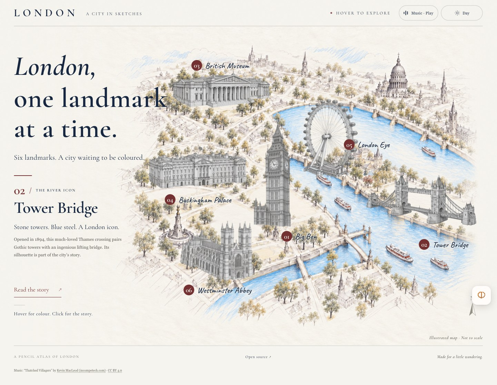

# London — A City in Sketches

An interactive pencil atlas of London. Explore six landmarks on an illustrated map, reveal their colour and open their stories without leaving the page.

[Visit the live atlas](https://nikihu-a.github.io/london-pencil-atlas/) · [Verification notes](VERIFICATION.md)

[](https://nikihu-a.github.io/london-pencil-atlas/)

## Project in brief

- **Audience & goal:** a visual introduction for people curious about London, connecting six landmarks with short stories and a sense of place.
- **My role & AI collaboration:** a Niki project developed through AI-assisted design and implementation. The illustrations were generated with ImageGen; their prompts are included in the repository.
- **Key decisions:** keep map exploration and stories on one page; offer touch and keyboard controls; make music optional; use an artistic map without a navigation API.
- **Validation:** the existing [verification record](VERIFICATION.md) covers all six stories, navigation, lighting, audio controls and narrow-screen layouts. Mobile checks used browser emulation.

一个围绕六座伦敦地标展开的插画地图实验，结合 Niki 的项目方向与 AI 协作制作，探索地图、故事和光线如何组成一页体验。

## Explore

- Hover a landmark to enlarge it by 15% and reveal its colour.
- Click a building to open its illustrated story in a modal on the same page. Close the story or press **Escape** to return to the map.
- Choose **Read the story** to open the currently previewed landmark.
- Use **Previous** and **Next** in the story to wander through all six landmarks without leaving the page.
- On a phone or tablet, tap a building to open its story.
- Choose **Music · Play** for a gentle folk instrumental, **Thatched Villagers** by Kevin MacLeod. Choose **Music · Pause** to stop. Music begins only after this explicit action, loops at a quiet volume and pauses when the tab is hidden.
- Use the upper-right **Day / Golden Hour** sun button to change the light. Golden Hour adds a softly fading warm sky, subtle building side light and shadows, and slow gold reflections on the Thames while keeping the ivory paper. The choice is remembered when browser storage is available.
- Use **Tab** to reach buildings, arrow keys to move between them, **Enter** or **Space** to select, and **Escape** to close a story or release a selection.
- Reduced-motion preferences are respected.

The map is an artistic interpretation of London, not a navigation map. It is labelled **Not to scale**.

## Landmarks

1. Big Ben
2. Tower Bridge
3. British Museum
4. Buckingham Palace
5. London Eye
6. Westminster Abbey

## Run locally

No package installation or build is required. Serve this directory with any static web server, for example:

```sh
python3 -m http.server 4173
```

Open `http://localhost:4173/`. Keep all files in their existing folders. The font files and illustrations are included locally; the website does not need a font CDN, map API, backend, account or API key.

## Publish on GitHub Pages

1. Put these files in a public GitHub repository.
2. Open **Settings → Pages**.
3. Under **Build and deployment**, select **Deploy from a branch**.
4. Choose **main** and **/ (root)**, then save.
5. GitHub publishes the site at `https://<username>.github.io/<repository>/`.

All asset paths are relative, so the site works under a project repository path. The `.nojekyll` file keeps GitHub Pages from running Jekyll.

## Project structure

```text
index.html                    Semantic page and six landmark controls
styles.css                    Layout, art direction, motion and responsive styles
app.js                        Map interaction, stories, lighting and music playback
assets/favicon.svg            Site-specific clock-tower favicon
assets/illustrations/         Pencil backdrop and transparent coloured landmarks
assets/fonts/                 Locally hosted fonts and their OFL licences
assets/audio/                 Local MP3 and separate music attribution
SOURCES.md                    Official sources for the landmark introductions
LICENSE                       MIT licence
```

## Design

The interface uses warm paper (`#F7F4ED`), navy ink (`#102641`) and a restrained blackened brick red (`#7D292D`). Cormorant Garamond supplies the book-like headings; Caveat supplies handwritten map labels. The title preserves generous letter spacing and line spacing.

The illustrations were generated specifically for this project using ImageGen. Each building is a separate transparent image. Default grayscale and active colour states use the same image, so the architectural silhouette stays consistent during the transition. The artwork-generation prompts are recorded in `assets/illustrations/image-prompts.md`.

## Content and licences

Landmark introductions are original summaries based on the official sources in [SOURCES.md](./SOURCES.md). This is an independent illustrated guide and is not an official tourism or ticketing service.

The original project code is available under the [MIT licence](./LICENSE). The generated illustrations are included with the project. Cormorant Garamond and Caveat are distributed under the SIL Open Font License; their licence files are included in `assets/fonts/`.

The background recording is licensed under **CC BY 4.0**, separately from the MIT-licensed code. Keep the visible footer credit and [audio attribution](./assets/audio/ATTRIBUTION.md) when redistributing.
